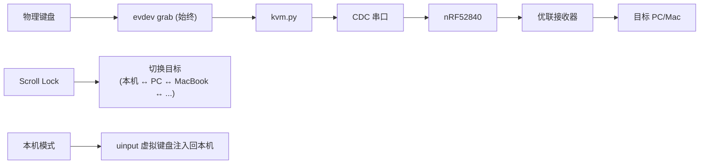

# unifying-kvm

键盘 KVM 转发器:把一个物理键盘的输入通过 nRF52840 优联发射器转发到多台电脑,用热键切换目标。

## 原理



- **键盘始终被 grab**:物理键盘永远处于独占抓取状态,确保可靠控制 LED
- **本机模式**:通过 uinput 虚拟键盘将按键事件注入回 OS
- **远程模式**:每个按键实时转发为 UKEY CDC 命令 → nRF52 加密发射 → 接收器解密注入
- **LED 指示**:Scroll Lock LED 闪烁指示当前目标(PC=1次, Local=2次, Mac=3次)

## 前提

- [nrf52-unifying](https://github.com/ZHLHZHU/nrf52-unifying) 固件已刷入 nRF52840,CDC 连接到 Pi
- 每个远程目标的 Logitech Unifying 接收器已配对到对应 slot(`UPAIR 0`、`UPAIR 1`、...)
- Pi 上安装了 Python 3 + evdev + pyserial

## 安装

```bash
pip install evdev pyserial
```

## 使用

```bash
# 查看可用键盘
sudo python3 kvm.py --keyboard list

# 启动转发(以 04d9:0024 键盘为例)
sudo python3 kvm.py --keyboard 04d9:0024 --port /dev/ttyACM0

# 自定义目标列表
sudo python3 kvm.py --keyboard 04d9:0024 \
  --targets "local:_,pc:0,macbook:1"
```

需要 `sudo` 是因为 evdev grab 需要 root 权限(或 input 组)。

## 参数

| 参数 | 说明 |
| --- | --- |
| `--keyboard` | 键盘的 vendor:product(如 `04d9:0024`)或 evdev 路径(`/dev/input/event5`) |
| `--port` | nRF52 CDC 串口(默认 `/dev/ttyACM0`) |
| `--targets` | 目标列表,格式 `name:slot,...`。slot 为数字(0-3)表示远程,`_` 表示本机 |
| `--debug` | 打印底层协议收发 |

## 热键

**Scroll Lock** = 循环切换到下一个目标

切换时会自动:
- 释放当前目标上所有按住的键(防止卡键)
- 远程目标:`USWITCH <slot>` 切换 nRF52 的活跃配对并自动重连
- 本机:切换到 uinput 注入模式
- LED 反馈:Scroll Lock LED 闪烁指示目标(PC=1次, Local=2次, Mac=3次,闪烁后熄灭)

## 目标配置

默认 `local:_,pc:0,mac:1`:

| 名称 | slot | 含义 |
| --- | --- | --- |
| `local` | `_` | 本机,键盘正常工作 |
| `pc` | `0` | nRF52 slot 0 的配对(Windows PC) |
| `mac` | `1` | nRF52 slot 1 的配对(MacBook) |

## 完整工作流

```bash
# 1. 在 Pi 上,先配对 slot 0 → PC 的接收器
sudo ltunify pair 60 &   # 在 PC 上执行
python3 ../nrf52-unifying/tools/unifying.py pair --port /dev/ttyACM0
# 等价于: echo "UPAIR 00" > /dev/ttyACM0

# 2. 配对 slot 1 → MacBook 的接收器
# (拔掉 PC 接收器,插上 Mac 接收器,或在另一台机器操作)
sudo ltunify pair 60 &   # 在 MacBook 上执行
echo -e "USWITCH 01\nUPAIR 01" | ...  # 或用 unifying.py

# 3. 启动 KVM
sudo python3 kvm.py --keyboard 04d9:0024

# 4. Scroll Lock 在 本机/PC/MacBook 之间切换
```

## 注意

- 传输延迟约 2-5ms(取决于射频重传),打字体验接近原生
- 保活由 nRF52 固件自动维持,长时间不打字也不会断连
- 接收器断电后需重新 `UCONNECT`(USWITCH 自带重连)
- 串口热路径采用 fire-and-forget 设计(不等待固件响应),不会因固件操作(如 USWITCH 扫频)阻塞事件循环
- 写超时 0.5s,串口异常静默捕获,丢帧由下一帧自动纠正,进程不会因串口问题崩溃
