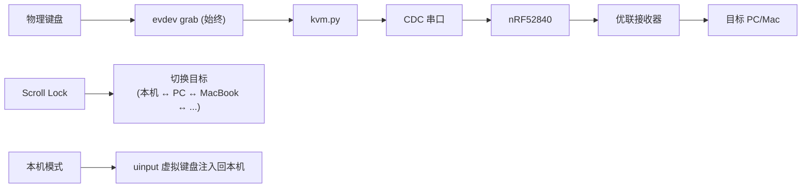

# unifying-kvm

键盘 KVM 转发器:把一个物理键盘的输入通过 nRF52840 优联发射器转发到多台电脑,用热键切换目标。

## RP2040 主控

当前运行在 RP2040 + nice!nano 兼容模组自制一体板，构建沿用 `PICO_BOARD=pico`，Flash 设置为 16MiB。实际接线、SWD、仓库位置与验收状态见 [当前硬件记录](docs/HARDWARE.md)，nRF 更新见 [UART OTA](docs/UART-OTA.md)，从树莓派迁移以来的弯路与结论见 [开发历程](docs/JOURNEY.md)。

`rp2040/` 固件路径：

```text
USB HID 键盘 → Pico 原生 USB Host → UART1 → nRF52840 → Unifying 接收器
```

- Rust 管理 HID 解码、完整按键状态、128 项变化 FIFO、编号 ACK、切换、恢复和 LED；锁定 Pico SDK/TinyUSB 的 C 层仅提供启动与硬件桥接。
- 自动识别第一个标准 HID Keyboard collection，无品牌或 VID/PID 白名单。Boot 模式必须确认 SET_PROTOCOL 真正完成；Report-only 键盘按描述符解码数组、位图和修饰键。复合设备的鼠标/consumer/vendor collection 不转发。
- 传输 HID usages，不生成文本；键盘布局和输入法由目的电脑解释。无线仍最多六个普通键加八位修饰键，不是无线 NKRO。不支持 Hub、多键盘或鼠标转发。
- 三个目标 slot `00`/`01`/`02`。短按 Scroll Lock 在松开时切到下一个 slot（0→1→2→0），按"旧目标释放 ACK → 选择新目标 → 新目标释放 ACK"的屏障顺序执行；切换时已按住的键（含修饰键）必须松开后才在新目标生效。空 slot 也会停留，但不转发按键。
- 长按 Scroll Lock 3 秒：向当前 slot 发 `UPAIR`（目标电脑需先用 Solaar/ltunify 打开配对窗口），等待最多 30 秒。已配对的 slot 会被覆盖；配对失败时 nRF 恢复原配对。
- 板载 RGB（GP16/17/18，共阳，硬件 PWM）：slot 0 绿、slot 1 蓝、slot 2 红，三色按人眼亮度权重均衡（占空比 R 17% / G 5% / B 50%，蓝色为原全亮的一半）。连上时常亮；切换开始即显示新目标颜色；接收器未确认（nRF 回 `ERR SEND`）时以 5Hz 快闪；配对中以 2Hz 慢闪；故障白色（按 Scroll Lock 恢复）；启动/恢复握手期间熄灭。不再控制键盘 LED。
- 上电先初始化，不转发输入：发送 `VER`，单次等待 2 秒；无回复或回 `ERR BUSY` 后暂停 1 秒，用新编号再次探测，不设总等待上限。收到有效版本后选择 slot 0、确认释放，再等待键盘所有键松开。初始化中选择/释放命令无回复也回到版本探测；仅启动超时如此处理，运行期超时和协议/UART/键盘错误仍按故障处理。
- 每条 UART 命令只有一条在途，匹配编号及回复语义才确认。目标收不到时不设上限：同一报告每隔 20ms 用新编号重发（nRF 搜索中每条约 0.1s 回 `ERR SEND`，由后台保活跳频），灯快闪，期间按键排队，连上后按序发出。此时 Scroll Lock 仍可短按切走或长按重新配对：未确认的排队输入丢弃（未到达的接收器会自行超时释放按键）；离开旧目标和故障恢复时的释放只发一次、失败不等待。运行期超时 2 秒、溢出或 UART 错误进入 FAULT，不回放离线输入。Scroll Lock 在 FAULT 请求恢复而不切换。
- CDC DTR 打开是 nRF 维护独占；RP 收到 ERR BUSY 后每秒探测，维护结束查询实际 slot、确认释放并等待物理全释放后恢复。

### 构建与首刷

Pico SDK 必须是 `a1438dff1d38bd9c65dbd693f0e5db4b9ae91779`（2.2.0），TinyUSB 必须是其子模块 `86ad6e56c1700e85f1c5678607a762cfe3aa2f47`；CMake 会核对实际选中的 checkout，不混用 master 头文件。

```sh
rustup target add thumbv6m-none-eabi
cargo test --manifest-path rp2040/Cargo.toml --lib
cmake -S rp2040 -B rp2040/build -DPICO_BOARD=pico -DPICO_SDK_PATH=/home/lh/pico-sdk -DPICO_FLASH_SIZE_BYTES=16777216 -DRP_UART_SMOKE=OFF
cmake --build rp2040/build --target rp2040_kvm
```

输出 `rp2040/build/rp2040_kvm.elf` 和 `.uf2`。SDK 独占 boot2/向量表；`memmap.ld` 在 264KiB SRAM 内单独保留 16KiB 栈。Cargo 没有全局默认 target，宿主测试不链接 SDK。

```sh
sudo probe-rs download --chip RP2040 --probe 0d28:0204 --protocol swd \
  --speed 50 --non-interactive --verify --reset rp2040/build/rp2040_kvm.elf
```

也可按住 BOOTSEL 上电，将 UF2 复制到 Pico 的启动卷。运行时原生 USB 只接键盘，不同时作为电脑 USB device 调试口。若本机 `/tmp` 配额不足，可自行选有空间的目录设置 `TMPDIR`；不删除其他项目文件。

### 当前实板接线与供电

| RP2040 | 板内网络 | nRF52840 |
| --- | --- | --- |
| GP4 / UART1 TX | NRF_RXD | P0.06 / 006 RX |
| GP5 / UART1 RX | NRF_TXD | P0.08 / 008 TX |
| GND | 共地 | GND |

UART 为 1Mbps、8N1、无流控。P0.02 / 002 未连接。板 USB-C 供电，nRF 经 R12 从 VBUS 输入 5V；SWD 使用 SWDIO/SWCLK/GND，调试器电源输出断开。GP14 高有效控制键盘 VBUS，GP15 为低有效故障输入。

原 Pico 转接线联调记录属于历史方案，当前以 [HARDWARE.md](docs/HARDWARE.md) 为准。

### 双端 UART 诊断固件

默认构建仍是 KVM。排查 UART 时，两端必须都使用 `uart-smoke`，开机后每秒发送一条消息，不需要键盘、配对接收器或打开 CDC：

```text
Pico TX: #RP2040 PING 00000001<LF>
nRF TX:  #NRF52840 PING 00000001<LF>
```

序号为八位大写十六进制，从 1 开始。仅匹配完整 peer 前缀和序号才增加 `peer_frames`；支持 LF/CRLF、拆包和粘包。错误或损坏行丢弃到 LF。诊断模式不转发键盘或执行无线命令；nRF 的 CDC OTA 仍可用，其他无线命令返回 `ERR DIAGNOSTIC`。

```sh
cargo test --manifest-path rp2040/Cargo.toml --features uart-smoke --lib
cmake -S rp2040 -B rp2040/build-uart-smoke \
  -DPICO_BOARD=pico -DPICO_SDK_PATH=/home/lh/pico-sdk -DRP_UART_SMOKE=ON \
  -DPICOTOOL_FETCH_FROM_GIT_PATH=/home/lh/unifying-kvm/rp2040/build/_deps
cmake --build rp2040/build-uart-smoke --target rp2040_kvm
sudo probe-rs download --chip RP2040 --probe 0d28:0204 --protocol swd \
  --speed 50 --non-interactive --verify --reset rp2040/build-uart-smoke/rp2040_kvm.elf
```

诊断输出在独立 build 目录，不覆盖默认 KVM ELF/UF2。nRF 诊断构建、OTA 和 CDC `UARTTEST` 见其 `docs/USAGE.md` 第 9 节。

Pico 导出 `rp_uart_smoke_stats`，按顺序为七个 u32：`tx_frames`、`rx_bytes`、`peer_frames`、`bad_frames`、`uart_errors`、`last_peer_seq`、`task_count`。用 `arm-none-eabi-nm -S` 从当前诊断 ELF 获取地址，再用 `probe-rs read ... b32 <地址> 7`；地址不能套用到其他固件。运行中读取可能跨一次更新，需要精确一致快照时短暂 halt 后恢复运行。`tx_frames` 只证明完整消息交给 UART FIFO/DMA，不证明电气输出；对端完整 `peer_frames` 持续增加才证明该方向收到真实消息。

### 当前验证记录

- 实际电脑上的 `04b4:4042` 键盘描述符已读取：标准 63 字节 Keyboard collection、无 Report ID、8 字节输入、五位 LED 输出，键盘 IN `bInterval=10ms`。该 ID 仅作兼容性证据，不是白名单。
- 宿主 21 项 Rust 行为测试通过；Pico ELF/UF2 已构建，Pico 经 Air32 SWD 刷写并回读校验。
- 实机发现未接线 RX 的浮空噪声会触发 framing fault；增加 UART RX idle 上拉后，SWD 读到 `rp_debug_state=14`（FAULT）、`rp_debug_fault=1`（UART timeout），`rp_debug_task_count` 继续增加。没有伪造 nRF ACK 或报告 READY。
- nRF bootloader/app 经 Air32 识别为 `nRF52840_xxAA` 后首刷并回读校验，CDC 实际返回 `VER unifying/1 build=1790942502`、`STATUS SLOT=0 PAIRED=0 CONN=0 CH=5 CNT=0`；未配对的 all-up 返回 `ERR NOTCONN`，没有伪造 RF 成功。
- 8 项宿主 UART parser 测试通过；实际 CDC 完成同一份 42800 字节 app 的 WRITE → READY → 二进制 → OK → BOOT → REBOOT，再次硬件 reset、USB 重新枚举后返回 `STATE BOOT`。后续发现旧实现的延迟 reset 会被 CDC DTR 关闭取消；`REBOOT` 回复本身不能证明板子已重启。修正为会话外独立 reset future，默认与诊断构建均通过。
- UART 诊断新增 Pico 6 项、nRF 5 项 parser 测试，均通过；两端诊断固件已实际运行。Pico 的完整 peer 计数在约 3 秒内从 237 增至 240，nRF 序号从 238 增至 241，UART 错误计数 0；nRF CDC 读到 `peerframes=307 badframes=0 uart_errors=0 lastseq=00000245`。双向接收已证明，不将这些结果扩大为 KVM/RF 验收。
- nRF reset 后曾从 VMware Linux 消失，内核只有 USB disconnect；用户重新连接后 CDC 恢复并读到诊断计数。重启或 OTA 后须等 CDC 重新枚举，必要时重新连接到虚拟机，不能把旧端点或回复当新固件运行证明。
- 重启取消修复版 nRF 诊断 app 为 28688 字节，经 CDC 写入并实际启动。新版本 CDC 读到 `peerframes=429 badframes=0 uart_errors=0`、`STATE BOOT`。回归实测收到 `REBOOT` 后 4.485ms 即关闭 CDC（早于 100ms reset 延迟），Pico 随后观察到 nRF 序号从 483 重新变为 3，完整 peer 计数从 875 增至 879，证明 DTR 关闭不再取消已接受的重启。
- 当前两端已恢复正常 KVM。修复前启动超时复现；不 reset Pico、经 SWD 向 UART1 TX FIFO 发送第二条真实编号 VER，RX ring 读到项目版本，随后 USTATUS、USWITCH、all-up 如实返回 slot 0 未配对、`SWITCHED 0 EMPTY`、`ERR NOTCONN`。这是正常 parser/worker/reply 路径的复现证据，不是模拟 ACK。
- 正常 nRF 现启用 RX 上拉；Pico 先设置 RX idle/pin mux 再启用 UART，消除首字节 `FE` 污染；nRF 会话变化取消旧 DMA 等待，不再把 USB 枚举前采样的旧 epoch 附到新请求。取消时保留已接收 LF 的同步边界，丢弃旧会话的部分命令，不新增重试或特定坏字节过滤。
- 修复版已实际刷入。连续 8 次 Pico reset（其中 3 次在新 nRF OTA/USB 枚举后），KVM 状态机自然收到 `@00000001 VER unifying/1 build=1790947478`、`@00000002 SWITCHED 0 EMPTY`；不再 UART timeout 或首帧 ERR BUSY。当前是未配对引起的 Response fault（debug fault=5/detail=4），不是 READY。
- nRF parser 10 项测试通过，含新增的 DMA 取消完整 LF/残尾边界回归；正常与诊断 feature 均构建通过。实机 Pico `hid_dev`/`protocol_state` 数组均为 0，尚无 HID mount；下一步需要实际键盘及 PC/Mac 接收器配对窗口。
- slot 0 曾真实配对到 `E7D09A1D26`，KVM 自然完成 CONNECTED 和 all-up OK，无 fault，进入 WaitRelease（无 HID mount）。CDC `UKEY 00 04` 返回 OK，后续状态 PAIRED=1/CONN=1/CNT=5；尚无目的电脑可见输入记录。
- 配对状态下真实 CDC 独占/退出测试通过：Maintenance → VER/USTATUS/旧 all-up OK/USWITCH CONNECTED/新 all-up OK → WaitRelease，未模拟 ACK。
- 配对持久化故障已修复并实测通过（运行 `build=1790958045`）：空槽往返回到 slot 0 仍 `PAIRED=1 CONN=1` 且自动重连，counter 未倒退；nRF 重启后仍 `PAIRED=1`；Pico 重启后自然获得 `SWITCHED 0 CONNECTED` 与 all-up `OK`，无 fault。原因是 `storage.rs` 把脏无效记录当作擦除空位写入。掉电保留仍未测。
- `build.rs` 的 `rerun-if-changed=memory.x` 导致源码改动不更新 `BUILD_TIME`，`VER` 无法区分镜像；已移除，改用变化的时间戳确认实际运行版本。
- 维护后 UART VER 同步屏障已实测：CDC 开关一次后，真实 `UKEYDOWN 00 04` 收到 `ERR BUSY`，`VER` 解除屏障后 all-up 返回 `OK`，避免维护改槽后键击直接落入新 slot。
- 未验证 Pico 实际键盘 mount/LED、UART 电压/波形、nRF 无线/无 CDC 保活、存储掉电、PC/Mac 输入或延迟。**这不是阶段一完成或端到端验收通过。**

上述开发板联调完成后才适合日常 cutover。延迟需同一新 nRF、键盘、接收器和目标电脑做 Pi CDC/RP UART A/B；每组至少 10000 次，统计 p50/p95/p99/max 和丢按/释放。10ms 键盘轮询与 UART 理论时长不是端到端性能证据。

以下章节为保留的 **Pi/Python 基线**，与 RP 固件的路由和确认机制不同。

## 原理



- **键盘始终被 grab**:物理键盘永远处于独占抓取状态,确保可靠控制 LED
- **本机模式**:通过 uinput 虚拟键盘将按键事件注入回 OS
- **远程模式**:每个按键实时转发为 UKEY CDC 命令 → nRF52 加密发射 → 接收器解密注入
- **LED 指示**:Scroll Lock LED 闪烁指示当前目标(PC=1次, Local=2次, Mac=3次)

## 前提

- [nrf52-unifying](https://github.com/ZHLHZHU/nrf52-unifying) 固件已刷入 nRF52840,CDC 连接到 Pi
- 每个远程目标的 Logitech Unifying 接收器已配对到对应 slot(`UPAIR 0`、`UPAIR 1`、...)
- Pi 上安装了 Python 3 + evdev + pyserial

## 安装

```bash
pip install evdev pyserial
```

## 使用

```bash
# 查看可用键盘
sudo python3 kvm.py --keyboard list

# 启动转发(以 04d9:0024 键盘为例)
sudo python3 kvm.py --keyboard 04d9:0024 --port /dev/ttyACM0

# 自定义目标列表
sudo python3 kvm.py --keyboard 04d9:0024 \
  --targets "local:_,pc:0,macbook:1"
```

需要 `sudo` 是因为 evdev grab 需要 root 权限(或 input 组)。

## 参数

| 参数 | 说明 |
| --- | --- |
| `--keyboard` | 键盘的 vendor:product(如 `04d9:0024`)或 evdev 路径(`/dev/input/event5`) |
| `--port` | nRF52 CDC 串口(默认 `/dev/ttyACM0`) |
| `--targets` | 目标列表,格式 `name:slot,...`。slot 为数字(0-3)表示远程,`_` 表示本机 |
| `--debug` | 打印底层协议收发 |

## 热键

**Scroll Lock** = 循环切换到下一个目标

切换时会自动:
- 释放当前目标上所有按住的键(防止卡键)
- 远程目标:`USWITCH <slot>` 切换 nRF52 的活跃配对并自动重连
- 本机:切换到 uinput 注入模式
- LED 反馈:Scroll Lock LED 闪烁指示目标(PC=1次, Local=2次, Mac=3次,闪烁后熄灭)

## 目标配置

默认 `local:_,pc:0,mac:1`:

| 名称 | slot | 含义 |
| --- | --- | --- |
| `local` | `_` | 本机,键盘正常工作 |
| `pc` | `0` | nRF52 slot 0 的配对(Windows PC) |
| `mac` | `1` | nRF52 slot 1 的配对(MacBook) |

## 完整工作流

```bash
# 1. 在 Pi 上,先配对 slot 0 → PC 的接收器
sudo ltunify pair 60 &   # 在 PC 上执行
python3 ../nrf52-unifying/tools/unifying.py pair --port /dev/ttyACM0
# 等价于: echo "UPAIR 00" > /dev/ttyACM0

# 2. 配对 slot 1 → MacBook 的接收器
# (拔掉 PC 接收器,插上 Mac 接收器,或在另一台机器操作)
sudo ltunify pair 60 &   # 在 MacBook 上执行
echo -e "USWITCH 01\nUPAIR 01" | ...  # 或用 unifying.py

# 3. 启动 KVM
sudo python3 kvm.py --keyboard 04d9:0024

# 4. Scroll Lock 在 本机/PC/MacBook 之间切换
```

## 注意

- 传输延迟约 2-5ms(取决于射频重传),打字体验接近原生
- 保活由 nRF52 固件自动维持,长时间不打字也不会断连
- 接收器断电后需重新 `UCONNECT`(USWITCH 自带重连)
- 串口热路径采用 fire-and-forget 设计(不等待固件响应),不会因固件操作(如 USWITCH 扫频)阻塞事件循环
- 写超时 0.5s,串口异常静默捕获,丢帧由下一帧自动纠正,进程不会因串口问题崩溃
