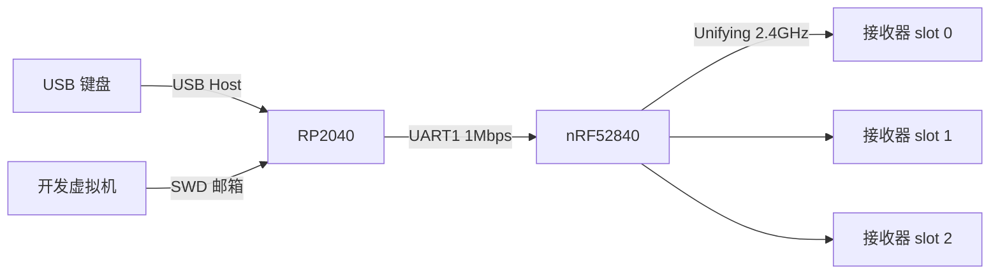

# 开发历程：从树莓派到 RP2040 一体板

本文按时间顺序记录这个项目走过的每一段路，包括弯路、错误判断和最终结论，方便以后接手者避开同样的坑。当前实板配置、接线和操作以 [HARDWARE.md](HARDWARE.md) 为准；nRF 更新流程见 [UART-OTA.md](UART-OTA.md)。

## 1. 起点：树莓派版本

最初的 KVM 是树莓派上的 Python 进程（`kvm.py`）：grab 物理键盘、通过 USB CDC 向 nRF52840 发 `UKEYDOWN`，用 Scroll Lock 切目标并闪键盘 Scroll Lock 灯。它能用，但依赖一台常开的树莓派。

迁移目标：RP2040 直接做 USB Host 读键盘，用 UART 控制 nRF；无线协议、配对存储和 AES counter 保护仍留在 nRF（[nrf52-unifying](https://github.com/ZHLHZHU/nrf52-unifying)）。

## 2. 开发板阶段

- RP 侧用 Rust 写业务（HID 解码、FIFO、编号 ACK、切换状态机），Pico SDK + TinyUSB 只做启动与硬件桥接；`bridge.h` 固化 C/Rust ABI。
- nRF 侧把保活从 CDC 会话里拆出来，新增 UART 入口和带编号的帧协议（`@XXXXXXXX <命令>`）；UART 和 CDC 共用一个无线 worker，避免两份无线状态。
- 双端 `uart-smoke` 诊断固件先证明 UART 双向收发，再做正式联调。
- 联调发现并修掉：RP 启用 UART 前未设 RX idle，首字节 `FE` 污染回复；nRF 会话切换后旧 DMA 残尾被拼成新命令；`build.rs` 的 `rerun-if-changed` 使 `BUILD_TIME` 不更新，`VER` 无法区分新旧镜像；NOR flash 日志把“无效但未擦除”的记录当空位写，切槽后配对丢失。

**弯路：** Pico 开发板接 iKBC 时键盘 VBUS 无 5V，一开始在固件上找原因。实测 `SIE_STATUS` 速度位为 0、SOF 计数为 0，而 `SIE_CTRL` 显示 host 模式和下拉均已启用，结论是供电问题而非固件，这直接促成了一体板。

## 3. 一体板：上电与 UART

- 板子：RP2040 + 16MiB W25Q128、nice!nano 兼容 nRF52840 模组、TPS2553 限流的 USB-A Host、共阳 RGB（GP16/17/18）、USB-C 供电。
- **接线变更：** 实板是 GP4 → P0.06（nRF RX）、GP5 ← P0.08（nRF TX）。开发板时代的 P0.02/P0.06 配置不再适用，nRF 固件改为 `Uarte::new(p.UARTE0, p.P0_06, p.P0_08, …)`。
- nRF 的 USB 被电容挡住，不能用 CDC OTA。于是做了 **UART OTA**：电脑 → SWD 写 RP RAM 邮箱（`rp_ota_mailbox`）→ RP 转发到 UART → nRF 写 DFU 区、CRC 校验、bootloader 换镜像。脚本是 `rp2040/nrf_uart_update.py`；它拒绝没有 OTA 能力标记的镜像，以免更新后失去更新通道。

## 4. 键盘不出字：最长的一段弯路

现象：键盘能枚举、Boot 协议设置成功，但按住右箭头时 TinyUSB 中断 IN 回调一直为 0，KVM 永远停在 `WAIT_RELEASE`。

依次排查且**都不是根因**的方向：

| 尝试 | 结果 |
| --- | --- |
| 读 `SIE_STATUS`/SOF 判断“无设备、硬件故障” | 读错了寄存器：速度位当成 17:16（实为 9:8），SOF 读成 `USB_BASE+0x28`（实为 `+0x48`）。结论撤回 |
| Rust 只绑定第一个键盘接口 | 确实是限制，但两个接口都提交接收也没数据 |
| Boot / Report 协议、`SET_IDLE` 16ms | 无变化 |
| UART-smoke 固件（无 KVM 解码）对照 | 同样 0 回调，排除 Rust 层 |
| 启动时显式总线复位、缓冲写入间隔加长 | 无变化 |
| 延迟启用轮询直到缓冲就绪 | 无变化 |

**转折点：** 用一个空闲 DMA 通道只读采样 `USBPHY_DIRECT`，通过 SWD 导出 SRAM，再做 NRZI/位填充/CRC 解码（原始数据在 `rp2040/build/tmp/`，未提交）。结果是 344 组 `IN 0x81` 后面都跟着 CRC 正确的 **DATA1** 全零包，**主机从未回 ACK**，而软件提交的缓冲期待 DATA0。把首包强制改成 DATA1 后收到 3 次真实右箭头（`0x4f`），随后又卡死。

**根因：** RP2040 芯片缺陷（[pico-feedback #394](https://github.com/raspberrypi/pico-feedback/issues/394)、[TinyUSB #2776](https://github.com/hathach/tinyusb/issues/2776)）。硬件自动轮询的 EP1–15 收到 PID 不符的数据包时既不 ACK，也不报 `DATA_SEQ_ERROR`，设备于是无限重发同一个包。截至 2026-10-11，上游 TinyUSB master 仍使用这条路径。

**教训：** 抓到线上包之后，应该第一时间拿特征去对照已知缺陷；前面在 Rust、协议模式、时序上花的时间都可以省掉。

**修复：** `rp2040/native/hcd_epx.c` 替换 SDK 的 `hcd_rp2040.c`（CMake 从 `tinyusb_host_base` 移除原文件）。所有端点都走软件调度的 EPX：每次只做一次握手，NAK 时按 `bInterval` 重新排队；遇到 `DATA_SEQ_ERROR` 时 EPX 按 USB 规范 8.6.4 回 ACK 并丢弃该包，PID 不翻转。

**修复中的回归：** 新 HCD 在 `hcd_port_reset` 里置位 `SIE_CTRL.RESET_BUS`。控制器把它当成一次重新插入，每 ~500ms 断开重连，`tuh_task` 永远卡在枚举延时里（SWD 停核看到 PC 一直在 `sleep_ms` ← `enum_new_device`）。插入时的总线复位由控制器自动完成，因此改为空实现，与上游一致。

**另一个失误：** 有一次验证命令里的 `grep` 正则写错，把编译失败掩盖了，结果烧进去的还是旧固件。之后每次烧录前都用 `ls` 时间戳和 `arm-none-eabi-nm` / `objdump` 确认镜像里确实有新代码。

结果：键盘稳定挂载；60 秒内收到 29 份报告；用户确认目的电脑同步出字。

## 5. 第二路配对

- 配对命令 `UPAIR` 原本只能从 nRF CDC 发，但 CDC 口被挡住了。UART 白名单新增 `UPAIR <slot>`，slot 必须显式给出；`UDELETE` 仍禁止。
- RP 邮箱转发的超时从 5 秒放宽到 30 秒（`UPAIR` 最多扫 8 轮），`nrf_uart_update.py` 新增 `--command`。
- Linux 端用 Solaar 打开配对窗口，`UPAIR 01` 第二次尝试成功（`PAIRED A54A930029 CH=44`）。
- 一处错误预期：我以为配对后默认目标会变成新 slot，实际 RP 启动流程固定先 `USWITCH 00`。

## 6. 指示灯：从键盘灯到板载 RGB

1. 原设计闪的是键盘 Scroll Lock 灯（HID SET_REPORT），板载 RGB 根本没被驱动。用 SWD 直接拉低 GP16–18 确认 RGB 硬件正常。
2. 先做成“常亮 + 切换后闪 1/2 下”，随后用户要求 3 个 slot、直接切颜色。
3. 最终版本：slot 0 绿、1 蓝、2 红，常亮；配对 2Hz 慢闪；连不上 5Hz 快闪；故障白色。
4. 移除了 HID 输出报告路径（`bridge_hid_set_report`、`led_report`），描述符里 LED 字段写法异常的键盘也因此能挂载。
5. 用户反馈绿色太刺眼。GPIO 只有高、低两种电平，做不了 DC 调光，于是改用硬件 PWM（125kHz）：占空比按人眼亮度权重（Rec.709）的反比分配，蓝色定为原全亮的 50%，结果为 R 17% / G 5% / B 50%。用户确认舒服多了。按推算，1kΩ 限流下三色的正向压降不同，实际电流可能差几倍，所以这组比例只是起点，可以用 SWD 写 `rp_rgb_level` 继续微调。

## 7. 三个 slot 与长按配对

- 短按 Scroll Lock **在松开时**切到下一个 slot（0→1→2→0）；否则无法区分短按和长按。
- 长按 3 秒对当前 slot 发 `UPAIR`；已配对的 slot 可以覆盖。nRF 改为配对失败时恢复原配对，因为 `pair()` 过程中会逐步改写地址、密钥和信道。
- 空 slot 也会停留（红灯），按键不转发，也不向它发释放。
- 切换状态机里不需要发命令的转移（空槽释放、屏障开始）现在在同一次 `task()` 内连锁执行。

## 8. 切换后白灯：超时上限的演变

| 版本 | 规则 | 实测问题 |
| --- | --- | --- |
| 初版 | `ERR SEND` 每 8ms 重试，最多 3 次 | 切到 slot 1 后 nRF 连续 2.5s 回 `ERR SEND`，~30ms 即白灯 |
| 5 秒窗口 | 20ms 重发，5s 后故障 | 现场有一次 >6s，仍然白灯 |
| 15 秒窗口 | 同上，15s | 蓝色使用中掉线 15s，白灯 |
| **当前** | **不设上限**，一直快闪重发 | — |

nRF 侧机制：`USWITCH` 不做 `connect()`，只配置射频，靠后台保活和发送失败时 `advance_channel()` 逐个试信道。每个 `ERR SEND` 背后是 20 次发送尝试，约 1.4 秒。重连耗时实测从 0.05s 到 6s 以上不等。

用户提出“不用超时，一直待连接、闪灯，督促 nRF 重试”，这比任何固定上限都更合理：

- 同一报告每 20ms 用新编号重发，灯快闪，按键排队，连上后按序发出。
- 连不上时 Scroll Lock 仍然有效：短按切走、长按重新配对。未确认的排队输入直接丢弃（接收器没收到“按下”，或者会自行超时释放）。
- 离开旧目标时的释放只发一次（`start_once`，`ERR SEND` 视为 `Unreached`），不会被一个关机的目标卡住。
- `Fault::Send` 已删除；白灯只剩 UART、协议和键盘层面的真正故障。

已排除的原因：Linux 端接收器 USB 自动挂起是关的（`power/control=on`），19:16 前后也没有休眠或断开记录。

## 8.5 快速连按 Scroll Lock 时白灯与灯灭：四个独立 bug

不设上限之后，用户用“连不上时快速连按 Scroll Lock”稳定复现了白灯（`UART timeout`）。我写了一个常驻 SWD 日志器（50ms 轮询 KVM 状态、诊断环、PWM、USB 供电与 GPIO 复用），每次故障后再 dump RP 的 UART RX 环形缓冲，看 nRF 最后回了什么。

| 现象 | 根因 | 修复 |
| --- | --- | --- |
| RELEASE_OLD 停 2s 后白灯 | nRF 一条 `UKEYDOWN` 连不上时阻塞约 1.4s；RP 放弃它后发的下一条要排在后面 | 先在 RP 上做了“被放弃命令计数、延长超时”，用户认为太绕，**撤回**；改为 nRF `link_up` 状态机：搜索中每条命令只试一次，约 0.1s 必回 |
| 修完仍偶发白灯，RX 缓冲停在半截回复 | nRF 回复队列容量 1，满时 `try_send` 失败就丢回复并把 UART 标为损坏，后续请求全部作废 | 回复入队改为 `send().await` |
| 修完仍偶发白灯，最后一条是 `ERR SEND` 后 nRF 静默 | 普通 `Uarte` 只在读 future 被轮询时接收；worker 阻塞发射频期间到达的行直接丢失 | 换 `BufferedUarte`，1KB 环形缓冲硬件持续接收 |
| 灯灭、不能输入也不能切换，过一会自己好 | 白灯恢复时落到连不上的 slot，`RECOVER_NEW` 无限重试 all-up；该状态灯映射为熄灭且 Scroll Lock 被屏蔽 | `RECOVER_NEW` 的 all-up 改为只发一次，失败直接进 READY |

复现方法都是用 SWD 驱动 RP 的 DMA 把多条命令按设定间隔直接写进 UART1 TX，看 RX 环里回了几条。手动一条一条发永远正常，这也是前几轮没抓到的原因。用户怀疑过看门狗，读 `WATCHDOG_REASON`=0、uptime 连续，排除。

## 9. 现状与待办

已可日常使用：三目标切换、长按配对、RGB 状态、连不上时无限重试。

仍未完成：

- nRF 切换后重连慢：可以在 `USWITCH` 时主动 `connect()` 扫全部信道，或记住每个 slot 上次成功的信道。
- 长时间掉线（15 秒）根因：当时 nRF 每条命令阻塞 1.4s 且会丢行，可能就是这批 bug；修复后需要再观察。
- lh-magicbook 上 Solaar 报 `No supported device found`，疑似 hidraw 权限，需要 sudo 才能排查。
- 只绑定第一个键盘接口（iKBC 接口 1 的 NKRO 位图不读）。
- 普通鼠标或简单键盘的对照测试、USB 电气波形、带载浪涌、掉电后配对与 counter 保留均未验证。
