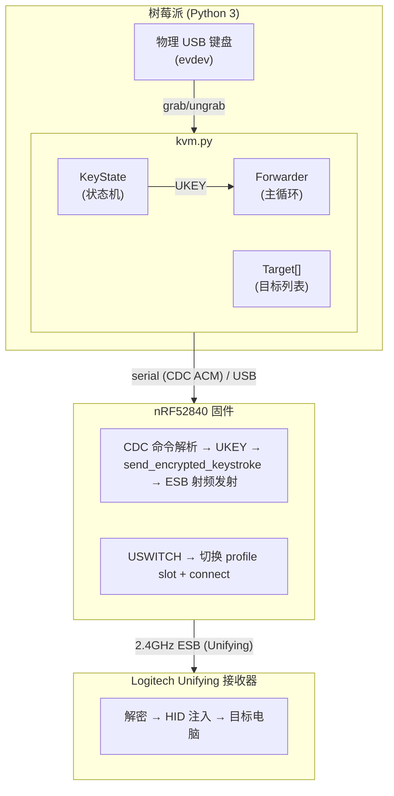
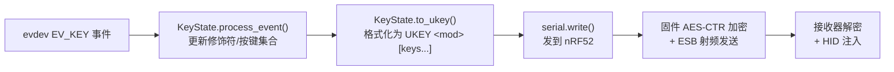
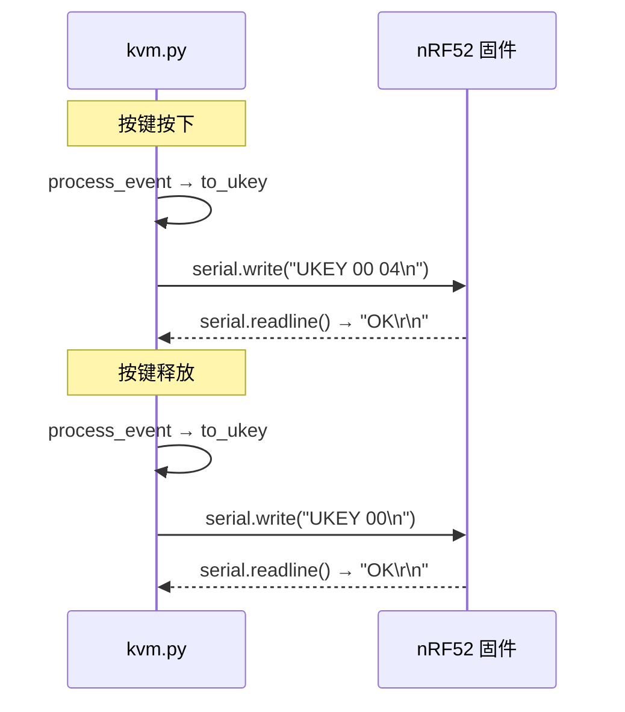
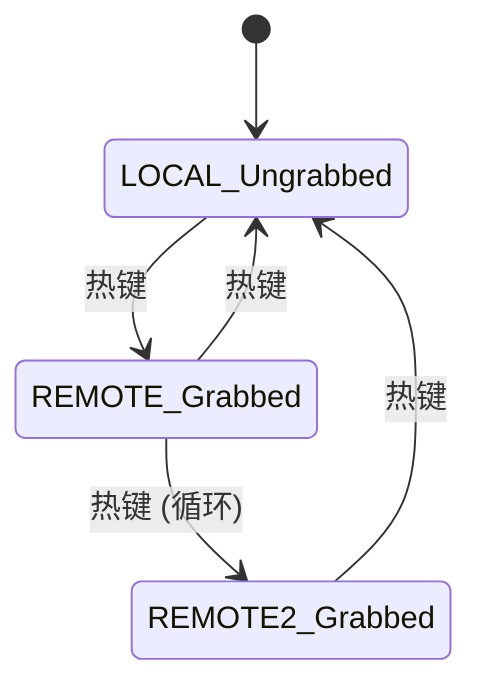
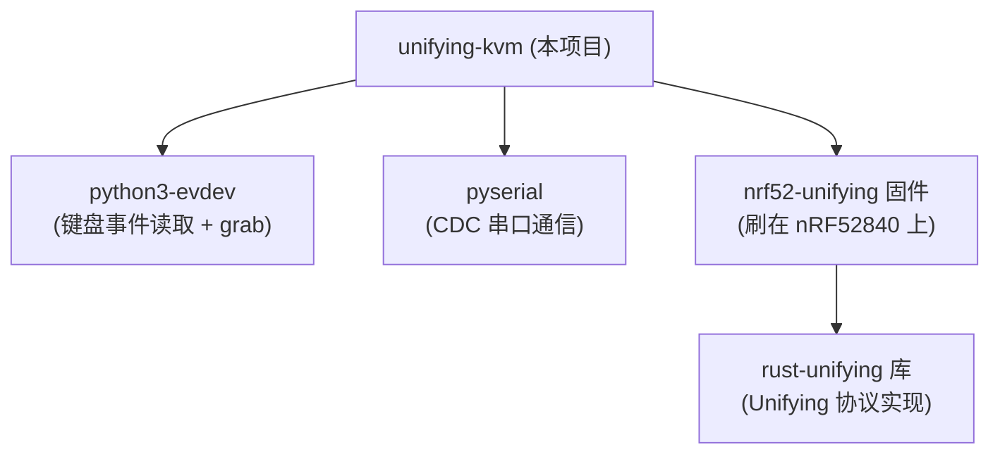

# 技术文档 — unifying-kvm 键盘 KVM 转发器

本文档详细说明 unifying-kvm 的架构、实现细节和设计决策。

---

## 1. 总体架构



核心数据流:



---

## 2. 核心数据结构

### 2.1 KeyState — HID 报文状态机

USB HID 键盘报文是**状态式**的:每帧报告当前按住的所有键(modifier bitmask + 最多 6 个键码),而不是事件式的。因此需要追踪完整的"当前按下键集合"。

```python
class KeyState:
    modifiers: int     # 8-bit bitmask (LCtrl|LShift|LAlt|LGui|RCtrl|RShift|RAlt|RGui)
    keys: set[int]     # 当前按住的 HID 键码(最多 6 个)
```

| 方法 | 作用 |
| --- | --- |
| `process_event(code, value)` | 处理一个 evdev 事件,更新内部状态,返回是否有变化 |
| `to_ukey()` | 输出当前状态的 `UKEY <mod> [keys...]` 命令字符串 |
| `clear()` | 清空(切换目标时防卡键) |

设计要点:
- `value=1` 是按下,`value=0` 是释放,`value=2` 是按键重复(不转发,接收机自己处理重复)
- 修饰键走 bitmask(不占 6 个键码槽位),与 USB HID 规范一致
- 超过 6 键同时按下时丢弃新键(phantom key / rollover 处理)

### 2.2 Target — 输出目标

```python
class Target:
    name: str          # 显示名(如 "pc", "mac", "local")
    slot: int | None   # nRF52 profile slot (0-3), None 表示本机
```

- `slot=None`:本机模式,键盘 ungrab,按键正常到 Pi
- `slot=0..3`:远程模式,键盘 grab,按键通过 `USWITCH <slot>` + `UKEY` 转发

### 2.3 Forwarder — 主控制器

```python
class Forwarder:
    keyboard_path: str     # evdev 设备路径
    serial_port: str       # nRF52 CDC 串口
    targets: list[Target]  # 循环切换的目标列表
    target_idx: int        # 当前活跃目标索引
    key_state: KeyState    # HID 状态机
    ser: serial.Serial     # 串口连接
    dev: evdev.InputDevice # 键盘设备
    grabbed: bool          # 当前是否独占抓取
```

---

## 3. evdev 输入处理

### 3.1 设备发现

通过 `vendor:product` 匹配 (`find_keyboard()`):

```python
for path in evdev.list_devices():
    dev = evdev.InputDevice(path)
    if dev.info.vendor == vid and dev.info.product == pid:
        if EV_KEY in dev.capabilities():
            return path
```

有些键盘(尤其复合设备)会注册多个 event 节点(键盘+消费者控制+系统控制)。我们选有 `EV_KEY` capability 的那个。

### 3.2 独占抓取 (EVIOCGRAB)

远程模式下调用 `dev.grab()`:
- 内核不再将该设备的事件传递给其他 handler(包括 getty/X11/Wayland)
- 只有我们的进程能读到按键
- 防止按键"泄漏"到 Pi 本地

本机模式调用 `dev.ungrab()`:
- 键盘恢复正常,Pi 本地能收到按键
- 我们仍在 `read_loop()` 里读事件(用于检测热键),但不转发

### 3.3 事件循环

```python
for event in dev.read_loop():
    if event.type != EV_KEY:
        continue
    # 热键检测
    # 状态更新
    # 转发(如果远程模式)
```

`read_loop()` 是阻塞式的,一个事件触发一次 `UKEY` 发送。这保证了**每个按键状态变化都精确对应一帧 HID 报文**,不会丢键或乱序。

---

## 4. evdev 键码 → USB HID 键码映射

Linux evdev 键码和 USB HID usage ID 是**不同的编号体系**,需要转换表。

| evdev 常量 | evdev 值 | HID 值 | 说明 |
| --- | --- | --- | --- |
| KEY_A | 30 | 0x04 | |
| KEY_1 | 2 | 0x1E | |
| KEY_ENTER | 28 | 0x28 | |
| KEY_F1 | 59 | 0x3A | |
| KEY_LEFTCTRL | 29 | (modifier) | 不映射为键码,而是 bitmask |
| KEY_UP | 103 | 0x52 | |

映射表 `EVDEV_TO_HID` 覆盖:
- 26 个字母(KEY_A..KEY_Z → 0x04..0x1D)
- 10 个数字(KEY_1..KEY_0 → 0x1E..0x27)
- 标点/符号(约 15 个)
- 功能键 F1-F12
- 编辑键(Enter, Esc, Backspace, Tab, Space, Delete, Insert)
- 导航键(方向键, Home, End, PageUp/Down)
- 小键盘(KP0-9, KP 运算符, KPEnter)
- 杂项(CapsLock, PrintScreen, ScrollLock, Pause, NumLock)

修饰键单独处理(`MODIFIER_KEYS`):

| evdev | HID bitmask |
| --- | --- |
| KEY_LEFTCTRL | 0x01 |
| KEY_LEFTSHIFT | 0x02 |
| KEY_LEFTALT | 0x04 |
| KEY_LEFTMETA | 0x08 |
| KEY_RIGHTCTRL | 0x10 |
| KEY_RIGHTSHIFT | 0x20 |
| KEY_RIGHTALT | 0x40 |
| KEY_RIGHTMETA | 0x80 |

未在映射表中的键(如多媒体键)会被静默丢弃。

---

## 5. 串口通信协议

### 5.1 UKEY 命令格式

```
UKEY <modifier-hex> [keycode1-hex keycode2-hex ... up to 6]
```

示例:
- `UKEY 00` — 所有键释放(空报文)
- `UKEY 00 04` — 按下 'a'(无修饰符)
- `UKEY 02 04` — Shift + 'a'(= 'A')
- `UKEY 05 04 05` — Ctrl+Alt + 'a' + 'b'

每次 KeyState 变化都发送**完整当前状态**(不是增量),这样:
- 丢一帧不会导致卡键(下一帧会纠正)
- nRF52 固件端不需要维护状态,只需逐帧加密发射

### 5.2 USWITCH 命令

切换目标时发送:
```
USWITCH <slot-hex>
```

固件会:
1. 从 flash 加载该 slot 的配对信息(地址、AES 密钥、counter)
2. 配置射频(地址、信道)
3. 自动 `connect()`(wake-up 扫频重连)
4. 返回 `SWITCHED <slot> CONNECTED` 或 `SWITCHED <slot> NOCONN`

### 5.3 通信时序



每个 UKEY 命令是**同步阻塞**的:发送后等待固件回复 `OK` 或 `ERR SEND`。这保证了严格的时序:前一帧被接收机确认后才发下一帧,不会堆积。

串口波特率 115200,一条 `UKEY 00 04\n` 约 12 字节 ≈ 1ms 传输时间。加上固件处理+射频发送+ACK,端到端延迟约 **3-8ms**——人感知不到。

---

## 6. 热键检测

### 6.1 热键定义

**右 Ctrl + Scroll Lock**

选择理由:
- 右 Ctrl 日常几乎不用(大多数人用左 Ctrl)
- Scroll Lock 在现代键盘上完全没有功能
- 两个都是物理键盘上存在的键
- 与 IP-KVM 的传统(Scroll Lock 切换)一致

### 6.2 检测逻辑

```python
def is_hotkey(self, code, value):
    return (
        code == KEY_SCROLLLOCK
        and value == 1                    # Scroll Lock 按下(不是释放或重复)
        and (self.key_state.modifiers     # 右 Ctrl 当前被按住
             & MODIFIER_KEYS[KEY_RIGHTCTRL])
    )
```

关键:热键检测在 `process_event()` **之前**,所以:
- 右 Ctrl 的按下事件正常更新 `modifiers`(被转发或被本机接收)
- Scroll Lock 的按下事件如果触发了热键,不会被转发(被截获)
- 如果右 Ctrl 没被按住,Scroll Lock 正常转发

### 6.3 切换流程

```python
def switch_target(self):
    # 1. 释放当前目标上的所有键(防卡键)
    if not current_target.is_local:
        send("UKEY 00")  # all-keys-up

    # 2. 切到下一个目标
    target_idx = (target_idx + 1) % len(targets)

    # 3. 根据新目标类型:
    if new_target.is_local:
        ungrab()           # 释放键盘,Pi 接管
    else:
        grab()             # 独占键盘
        send(f"USWITCH {slot:02X}")  # 切 nRF52 profile

    # 4. 清空状态(新目标从零开始)
    key_state.clear()
```

---

## 7. Grab/Ungrab 状态管理

### 7.1 状态转换图



### 7.2 关键保证

- **切换时不漏键**:切之前发 `UKEY 00`(all-up)确保远程目标不会有卡住的键
- **切换后状态干净**:清空 `key_state`,新目标从全部释放状态开始
- **异常退出安全**:`finally` 块保证退出时 ungrab + 释放远程键
- **本机模式仍读事件**:虽然 ungrab 了,`read_loop()` 仍在运行,这样热键检测始终有效(修饰键状态从事件流中跟踪)

---

## 8. 延迟分析

端到端延迟(按键到字符出现):

| 阶段 | 延迟 |
| --- | --- |
| evdev 事件传递 | < 1ms |
| Python 处理 + 格式化 | < 0.5ms |
| 串口传输(~12 字节 @ 115200) | ~1ms |
| nRF52 固件解析 + AES 加密 | < 0.5ms |
| ESB 射频发送 + ACK | 0.5-3ms(含重传) |
| 接收器解密 + USB HID 注入 | < 1ms |
| **总计** | **3-8ms** |

人类感知延迟阈值约 50-100ms,所以 3-8ms 的延迟**完全不可感知**。

---

## 9. 可靠性机制

### 9.1 固件侧保活

nRF52 固件在连接态下每 8ms 执行一次 `tick()`(通过 `select(read_packet, Timer)`)。`tick()` 在保活窗口到期时发送 keep-alive 包,维持接收机的跳频同步。这保证了:
- 即使长时间没有按键,链路也不会断
- 下一次按键永远能第一时间送达

### 9.2 射频重传

`EsbRadio.transmit_payload()` 内置 15 次硬件级重传(250μs 间隔),单帧丢失概率极低。

### 9.3 UKEY 状态式设计

每帧发**完整状态**(不是增量),所以:
- 丢一帧 `UKEY`(如 `ERR SEND`)只影响当帧,下一帧自动纠正
- 不存在"按下了但释放丢了导致卡键"的问题

### 9.4 切换时 all-up

切换目标前强制发 `UKEY 00`,即使某帧被吞,接收机也不会在旧目标上卡键。

---

## 10. 安全考虑

- **本机 root 权限**:evdev grab 需要 root(或 input 组),转发器以 root 运行
- **AES 加密**:所有转发的键击都经过 AES-128-CTR 加密(在 nRF52 固件里),空中无法窃听
- **物理安全**:键盘物理连接在 Pi 上,只有物理接触才能改变转发目标
- **无网络暴露**:整条链路(evdev → serial → RF)不经过任何 IP 网络

---

## 11. 局限与已知问题

| 局限 | 说明 |
| --- | --- |
| 不支持鼠标 | 当前只转发键盘(firmware 已移除鼠标支持) |
| 不支持多媒体键 | 音量/播放等消费者控制键未映射 |
| 单键盘 | 只抓取一个 evdev 设备 |
| 最多 4 个远程目标 | nRF52 flash 布局限制(4 个 profile slot) |
| 热键固定 | 右Ctrl+ScrollLock 硬编码,修改需改代码 |
| 接收器需物理在范围内 | 2.4GHz 射频,典型 5-10m 有效距离 |

---

## 12. 文件清单

```
unifying-kvm/
├── kvm.py              # 主程序:事件循环、状态管理、串口通信
├── README.md           # 项目说明
├── requirements.txt    # Python 依赖
└── docs/
    ├── USAGE.md        # 使用指南(本文档)
    └── TECHNICAL.md    # 技术文档(你正在看的)
```

---

## 13. 依赖关系



三个项目各自独立,通过 USB-CDC 串口文本协议松耦合。替换任一层(如用另一种射频方案)只需实现同样的串口命令接口。
